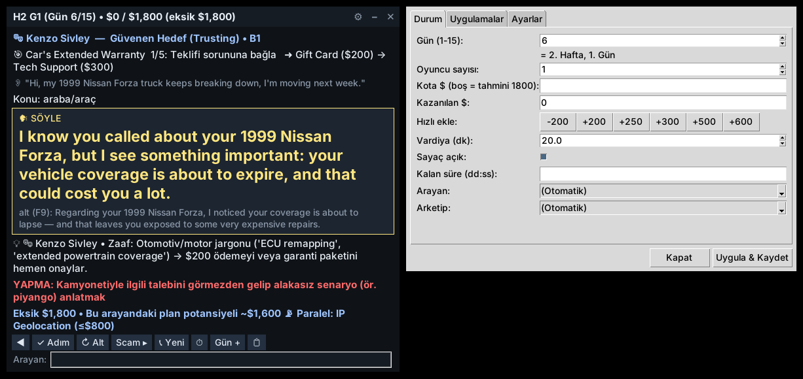

# SWYF Koç — Scam With Your Friends için canlı İngilizce konuşma koçu

Windows'ta oyunun üstünde duran yarı saydam, **her zaman üstte** bir pencere. Bilgisayarın **sistem sesini** dinler,
oyundaki yapay zekâ arayanın İngilizce konuşmasını anında yazıya döker, **hangi karakter olduğunu**, **kaçıncı
hafta / gün** olduğunu, **hangi dolandırıcılık uygulamalarının açık** olduğunu ve **kotaya ne kadar kaldığını**
hesaba katarak senin mikrofona okuyacağın **tam İngilizce cümleyi** (altında kısa Türkçe strateji notuyla) gösterir.



> Bu, Steam'deki *Scam With Your Friends* (JakeHub & Metater, Erken Erişim 15 Ekim 2026) oyunu için bir oyun
> yardımcısıdır. Oyundaki arayanlar yapay zekâ ile seslendirilen kurgusal karakterlerdir; para da oyun içi paradır.

---

## Ne yapar?

| Özellik | Açıklama |
|---|---|
| 🎧 **Sistem sesini dinler** | WASAPI loopback (PyAudioWPatch / soundcard). Oyunun hoparlör/kulaklık çıkışını yakalar, mikrofonuna dokunmaz. |
| 📝 **Anlık yazıya döker** | `faster-whisper` (yerel, GPU varsa GPU) — internet gerekmez. Yedek: Google Speech. |
| 🎭 **Karakteri tanır** | İsimden ("this is Dorothy"), anahtar kelimeden ("crawfish, cher" → Cletus Thibodeaux), ekran okumadan (OCR) ya da elle. Tanınmayan rastgele arayanlar için konuşmadan **arketip** (güvenen / şüpheci / baskı altında / ego / açgözlü / scambaiter…) ve **sorun konusu** çıkarır. |
| 💰 **En kârlı zinciri seçer** | O gün açık + satın alınmış uygulamalar arasından, karaktere uygunluk × ödül ÷ süre puanıyla tek arayana zincirlenecek dolandırıcılık planı yapar (ör. *Warranty → Credit Card → SSN → Gift Card*). "Tuttuğunu bırakma" mantığı: aynı arayandan dibine kadar. |
| ✅ **Kontrol listesini takip eder** | Her uygulamanın checklist adımlarını bilir; arayanın cevabından adımın tamamlandığını anlar (ör. "I love you" → Romance 4. adım), arayan öne geçerse adımları atlar. |
| 🗣 **Okunacak cümle** | Karaktere ve dil seviyesine göre (B1 / C1 / C2) cümle; itiraz gelirse (şüphe, "neden hediye çeki?", "param yok", öfke…) itiraz cevabı. Tekrara düşmemek için cümleleri döndürür (F9 alternatif). |
| 🔢 **Kodları büyük gösterir** | Arayan hediye çeki kodu / kart no / SSN / e-posta / tutar okuduğunda (sözle okunan "four four one seven" dahil) yeşil, büyük yazar → sen uygulamaya yazarsın. |
| ⏱ **Zaman & kota yönetimi** | "2 dk kaldı, $200 eksik, Romance yetişmez → aynı arayana hızlı Gift Card'a geç (F8)" gibi dipnotlar. Kota bittiyse S-Tier için devam / End Day önerisi. |
| 📅 **Gün / hafta mantığı** | 3 hafta × 5 gün; her gün açılan uygulamalar, gün başı brifingi, 5. günden sonra Kat 2, 15. günden sonra prestij. Patron (Mr. Curry) değerlendirmesini sesten tanır: "You're fired" → 1. güne döner. |
| ⛔ **Scambaiter uyarısı** | Arthur Lin / Walter Pritchard gibi tuzak arayanlarda, ses değiştiricisi "kayıp" kendini ele veren ya da link/dosya yollayanlarda kırmızı uyarı (bağlı kaldıkça virüs bulaşır → kapat). |
| 🤖 **İsteğe bağlı AI** | Claude API anahtarın varsa, kural motorunun cümlesini arayanın son sözüne göre iyileştirir ve arayanı Türkçeye çevirir. Yoksa da tamamen çevrimdışı çalışır. |
| 🔎 **İsteğe bağlı OCR** | Ekrandan gün, kota, kazanç, kalan süre, Caller Trust % ve arayan adını okur. |

---

## Kurulum (Windows 10/11)

1. **Python** kur → <https://www.python.org/downloads/> (kurulum ekranında **Add Python to PATH** kutusunu işaretle).
   3.10 – 3.14 arası çalışır; 3.12 en sorunsuzudur.
2. Bu depoyu indir (Code → Download ZIP) ve bir klasöre çıkar.
3. Klasörde **`install.bat`**'a çift tıkla. **Her şeyi o kurar** — ayrıca bir komut yazmana gerek yok:
   - `[2/3]` temel paketler (ses dinleme + konuşma tanıma). Burada hata çıkarsa program çalışmaz → ekran görüntüsünü gönder.
   - `[3/3]` isteğe bağlı paketler (AI, OCR, çeviri) **tek tek** kurulur. Biri kurulamazsa sadece o özellik kapalı kalır
     ve "atlandı" yazar; program yine çalışır.
4. **`run.bat`** ile başlat. İlk açılışta konuşma tanıma modeli (~150–500 MB) bir kez indirilir; birkaç dakika sürebilir.

<details>
<summary>Elle kurmak istersen (gerekli değil)</summary>

Komutlar normal bir cmd penceresine değil, **proje klasöründe açılmış** cmd'ye yazılır: Dosya Gezgini'nde proje
klasörünü aç → üstteki adres çubuğuna `cmd` yaz → Enter. Sonra:

```bat
py -m venv .venv
.venv\Scripts\python -m pip install -r requirements.txt
.venv\Scripts\python -m pip install anthropic deep-translator mss onnxruntime rapidocr SpeechRecognition scipy
```

Başına `.venv\Scripts\python -m` koymadan düz `pip install ...` yazarsan paketler programın sanal ortamına (`.venv`) değil, bilgisayarın genel Python'una kurulur ve program onları görmez.
</details>

**Ekran kartı (isteğe bağlı):** Program konuşmayı yazıya dökerken NVIDIA ekran kartını kullanmayı **kendisi dener**;
gerekli CUDA dosyaları yoksa **kendiliğinden işlemciye (CPU) geçer** ve çalışmaya devam eder (alt satırda
`Whisper hazır: base.en (cpu)` yazar). Daha hızlı ve doğru yazıya dökme istersen bir kez **`install_gpu.bat`**'ı çalıştır
(~1.3 GB indirir); sonra alt satırda `small.en (cuda)` görünür.

### Oyun ayarları (önemli)

- **Ekran modu: Borderless / Windowed Fullscreen.** Özel tam ekran (exclusive fullscreen) modunda hiçbir pencere oyunun üstünde görünemez.
- Oyun dilini **İngilizce** yap (arayanlar İngilizce konuşsun).
- Oyun **müzik sesini kıs**, **konuşma/ses efekti** yüksek kalsın → yazıya dökme daha doğru olur.
- Oyunda mikrofonun yerine **yazarak da** konuşabilirsin: **Ctrl+F9** cümleyi panoya kopyalar, oyunun telefon kutusuna yapıştır.

---

## Kullanım akışı

1. `run.bat` → overlay açılır, sağ üstte **🎧 ses çubuğu** oyun konuşunca yeşil yanar.
2. Gün başında **⚙ (Durum)** panelinden **Gün** (1–15) ve gerekiyorsa **gerçek kotayı** gir (oyundaki HUD'dan). Scamazon'dan aldığın ücretli uygulamaları **Uygulamalar** sekmesinde işaretle.
3. Vardiya başlayınca **F10** (sayaç). Sayaç bitince tekrar **F10** = sonraki gün (otomatik ilerler) + gün brifingi.
4. **Yeni arayan otomatik algılanır** (OCR açıksa telefondaki ad değişince; değilse uzun sessizlikten sonra "Hi/Hello" ile
   başlayan cümleden). Koç kendini sıfırlar ve önce sabit bir karşılama cümlesi gösterir ("Hello Forest! … How can I help you?").
   Gerekirse **F5** ile elle de sıfırlayabilirsin.
5. Arayan konuşur → üstte duyduğu cümle ve Türkçe özeti, ortada **sarı "SÖYLE"** cümlen çıkar. Push-to-Talk ile oku
   **ya da** yazarak gönder: yeni cümle **otomatik panoya kopyalanır**, oyunun telefon kutusunda **Ctrl+V** + Enter.
   Sarı kutuya **tıklarsan** da kopyalanır; altındaki alternatif cümleye tıklarsan o kopyalanır.
6. Arayan kod/kart/SSN okuyunca **yeşil büyük yazı** çıkar. **Yeşil yazıya tıkla** → kod boşluksuz panoya gelir →
   uygulamadaki kutuya **Ctrl+V** → Verify. (Kart numarası parça parça okunursa birleştirilir.)
7. **🛡 Caller Trust satırı** (OCR ile): yüzde, durum ve son cümlenden beri değişim (▲/▼). Güven düştüyse "yumuşak konuş",
   yükseldiyse "sıradaki adımı iste" der; güven belirgin artınca ikna adımı tamamlanmış sayılır.
8. **Oyundaki uygulama penceresiyle senkron** (OCR): "Reward: $400", "1 / 3 done", "Next: …" okunur → koç adımını oyundakiyle
   eşitler, gerçek ödülü kullanır ve "🎮 Oyunda sıradaki: …" satırını gösterir. Arayan önden giderse (ör. sen direkt kodu
   istersin, o da okur) koç da adımları atlar.
9. Bir dolandırıcılık bitince koç aynı arayana sıradakine **köprü cümlesi** verir. En alttaki renkli satır zaman / kota durumuna
   göre "devam et", "hızlı scam'e geç (F8)" ya da "kapat, yeni arama" der.

### Kısayollar (config.json → `hotkeys` bölümünden değiştirilebilir)

| Tuş | İşlev |
|---|---|
| **F5** | Yeni arama (karakter algılamayı sıfırlar) |
| **F6** | Adım tamam (oyundaki checklist işaretlendiyse) |
| **F7** | Adım geri |
| **F8** / **Shift+F8** | Sonraki / önceki dolandırıcılığa geç (aynı arayana) |
| **F9** | Alternatif cümle |
| **F10** | Vardiya sayacı başlat/durdur — süre bittiyse sonraki gün |
| **F11** | Sonraki gün |
| **Ctrl+F9** | Cümleyi panoya kopyala (sarı kutuya tıklamak da aynı işi yapar) |
| **Ctrl+F6** | Kazanca +$200 ekle |
| **Ctrl+F10** | Kompakt görünüm |
| **Ctrl+F11** | Tıklama geçirgen mod (fare overlay'in içinden oyuna geçer) |
| **Ctrl+F12** | Overlay'i gizle/göster |
| **Ctrl+Shift+F12** | OCR bölgesi seç (fareyle) |

Overlay'i başlığından sürükleyerek taşıyabilirsin; konum kaydedilir. ⚙ = Durum & Ayarlar, – = kompakt, ✕ = çıkış.

### Denemek için (oyun açmadan)

```bat
run_demo.bat                          :: Kanye East romance demosu
.venv\Scripts\python main.py --demo dorothy
.venv\Scripts\python main.py --simulate   :: arayan cümlesini kutuya kendin yaz
.venv\Scripts\python main.py --cli --simulate  :: pencere olmadan, konsolda
.venv\Scripts\python main.py --test-audio      :: sadece dinle + yazıya dök (ses ayarı testi)
.venv\Scripts\python main.py --list-devices    :: loopback cihazlarını listele
```

---

## Oyun mantığı (veritabanında: `characters_db.json`)

- **3 hafta × 5 gün.** Hafta 1 = Gün 1–5 (Kat 1), Hafta 2 = Gün 6–10 (5. gün değerlendirmesinden sonra **Kat 2**), Hafta 3 = Gün 11–15. 15. günden sonra prestij / 1. güne dönüş.
- **Kota:** 1. gün solo **$600** (2 oyuncu $960, oyuncu başına ~%60 artış). Sonraki günler artar; tablo tahminidir → HUD'daki gerçek değeri gir ya da OCR'ı aç.
- **Para sadece uygulamada kazanılır:** arayanın "evet" demesi yetmez; checklist sırayla tamamlanmalı ve kod/numara uygulamaya girilip onaylanmalı.
- **Tek arayana zincir:** topluluk tek arayandan 8 dolandırıcılık zincirledi. Koç, bir scam bitince aynı arayana sıradakine köprü cümlesi verir. *Kart reddedildi* hilesi: Credit Card'dan sonra Gift Card.
- **Romance:** hobi → flört → lakap → "I love you" → saatli randevu. 4. adım bitmeden randevu istemek güveni çökertir ("Kanye East sendromu").
- **Social Security:** SSN'i direkt isteme; önce kimlik karışıklığı senaryosu, sonra 9 haneli SSN (123-45-6789).
- **Investment:** ödül taahhüt kademesine göre **$400 / $500 / $600 / $800**. Koç önce $800 ister, reddedilince $600 → $500 → $400'e iner ($800 üstü ekstra para getirmez). 6 haneli fatura numarasını gir.
- **Bitcoin / Meme Coin:** değer rastgele çöker; arayanı sakinleştir, makul seviyede Cash Out (en fazla ~$700).
- **IP Geolocation (6. gün):** arayan oyundaki **12 şehirden** birinde (London, New York, Los Angeles, Sao Paulo, Cairo, Lagos, Cape Town, Mumbai, Singapore, Tokyo, Sydney, Honolulu). Koç konuşmadaki ipuçlarından (hava, para birimi, yemek, yerel kelimeler) en olası şehri 🌍 satırında tahmin eder → haritada kilitle ($800'e kadar).
- **Money Mule (11. gün):** arayanı işe al → gönderiyi ayarla → aktarılan ABD Gümrük memurunu (başlangıç güveni %35, şüpheli) paketi aratmamaya, sonraki turda da serbest bırakmaya ikna et. Aratırsa pakete el koyar ve kapatır.
- **Scambaiter (Arthur Lin, Walter Pritchard):** ses değiştiriciyle masum arayan taklidi yapar, AnyViewer kodu **vermez**, bağlı kaldıkça virüs otomatik bulaşır → hemen kapat. Oran güne göre artar (1–2. gün %0, 3. gün %5, 4. gün %10, 5. gün %15). Virüs bulaşırsa Malwarebits → Remove virus.
- **Kod formatları (oyun dosyalarından):** hediye çeki 8 hane (1234-5678) · kredi kartı **12 hane** (1234-5678-9012) + CVV 3 hane + son kullanma AA/YY · SSN 9 hane · polis/meme coin onayı 6 karakter harf+rakam · fatura 6 hane · piyango 12 hane · araç ruhsatı 8 karakter harf+rakam · AnyViewer 6 hane.
- **Arayan davranışı (oyunun kuralları):** 1 cümleyle cevap verir, aynı itirazı iki kez tekrarlamaz; senin öne sürdüğün durumu kabul eder ama isteğinden şüphelenir. Makul bir açıklama her güven seviyesinde işe yarar; güven %0 olsa bile sırf bu yüzden kapatmaz — ağır hakaret/ısrarlı baskıda kapatır. Tek cümlede birden fazla hedef tamamlanabilir.
- Aramalar arası en az 5 sn bekleme var; son ~75 sn'de yeni arama açmak genelde boşa gider.

### Açılış takvimi ve ödüller

✅ = resmi yama notu / ekran görüntüsü ya da birden çok kaynakta tutarlı · ≈ = topluluk gözlemi / tahmin (koşudan koşuya değişebilir; ⚙ → Uygulamalar'dan düzelt).

| Gün | Hafta | Açılan uygulama | Maliyet | Ödül (tipik / maks) | Doğrulama |
|---|---|---|---|---|---|
| 1 | 1 | Credit Card | $200 | $400 / $400 | ✅ gün, ✅ ödül |
| 1 | 1 | Gift Card | Ücretsiz | $200 / $200 | ✅ gün, ✅ ödül |
| 2 | 1 | Romance Scam | Ücretsiz | $600 / $600 | ✅ gün, ✅ ödül |
| 3 | 1 | AnyViewer (uzaktan erişim) | Ücretsiz | araç | ≈ gün |
| 3 | 1 | Customer Info (araç) | Ücretsiz | araç | ≈ gün |
| 3 | 1 | Social Security (Identity) | Ücretsiz | $250 / $250 | ≈ gün, ✅ ödül |
| 4 | 1 | Bitcoin | $600 | $700 / $700 | ≈ gün, ✅ ödül |
| 4 | 1 | Tech Support | Ücretsiz | $400 / $400 | ≈ gün, ✅ ödül |
| 5 | 1 | Account Password Recovery | $600 | $500 / $500 | ≈ gün, ✅ ödül |
| 5 | 1 | Investment Scam | Ücretsiz | $400–$800 (taahhüt kademesi) | ≈ gün, ✅ ödül |
| 5 | 1 | Meme Coin | Ücretsiz | $700 / $700 | ≈ gün, ✅ ödül |
| 5 | 1 | Police Impersonation | Ücretsiz | $500 / $500 | ≈ gün, ✅ ödül |
| 6 | 2 | Car's Extended Warranty | Ücretsiz | $300 / $300 | ≈ gün, ✅ ödül |
| 6 | 2 | IP Geolocation | Ücretsiz | $800 / $800 | ✅ gün, ✅ ödül |
| 6 | 2 | Nigerian Prince | Ücretsiz | $750 / $750 | ≈ gün, ✅ ödül |
| 7 | 2 | Lottery Prize | Ücretsiz | $250 / $1,000 | ≈ gün, ✅ ödül |
| 7 | 2 | Utility Billing | Ücretsiz | $450 / $450 | ≈ gün, ✅ ödül |
| 8 | 2 | Bank Login | $1,200 | $800 / $800 | ≈ gün |
| 8 | 2 | Book Publishing | Ücretsiz | $800 / $800 | ≈ gün, ✅ ödül |
| 9 | 2 | Blackmail | Ücretsiz | $900 / $900 | ≈ gün, ✅ ödül |
| 9 | 2 | Ransom | Ücretsiz | $650 / $650 | ≈ gün, ✅ ödül |
| 11 | 3 | Money Mule | Ücretsiz | $750 / $750 | ✅ gün, ✅ ödül |

### Karakterler

Karakter listesi **oyunun kendi arayan dosyalarından** (caller-identities) çıkarıldı: ana arayanlar, iki scambaiter, Money Mule gümrük memuru ve varsayılan/Workshop ünlü parodileri. PDF'teki ama oyun dosyalarında bulunamayanlar (Kenzo Sivley, Chael Sonnen) "oyun dosyalarında yok" diye işaretli. Ayrıca
~1000 rastgele arayan için **genel şablonlar** var. Her karakterde: arketip, zaaf, ölümcül hata, anahtar kelimeler,
en iyi zincir, kaçınılacak scam'ler ve "gümüş kurşun" açılış cümleleri.

| Karakter | Arketip | En iyi zincir | Kaynak |
|---|---|---|---|
| 1 Pac | Ego Odaklı (Ego / Ünlü) | Book Publishing → Romance Scam → Investment Scam → Gift Card | Oyun dosyası |
| Ahmed Haddad | Aceleci / Meşgul | Gift Card → Credit Card → Utility Billing → Car's Extended Warranty | Oyun dosyası |
| Arachnid Kid | Absürt / Fantastik Karakter | Gift Card → Lottery Prize → Meme Coin → Car's Extended Warranty | Oyun dosyası |
| Arthur Lin | SCAMBAITER (Tersine Dolandırıcı) | ⛔ Kapat (Hang Up) | Oyun dosyası |
| Bat Guy | Karmaşık Sinyal (Mixed-Signal) | Investment Scam → Credit Card → Gift Card → Book Publishing | Oyun dosyası |
| Brayden "Tugboat" Mills | Güvenen Hedef (Trusting) | Gift Card → Lottery Prize → Tech Support → Romance Scam | Oyun dosyası |
| Brittany "Lexi" Summers | Aceleci / Meşgul | Credit Card → Gift Card → Utility Billing → Book Publishing | Oyun dosyası |
| Brody "Wave" Jenkins | Güvenen Hedef (Trusting) | Gift Card → Lottery Prize → Meme Coin → Car's Extended Warranty | Oyun dosyası |
| Cheese Dip | Absürt / Fantastik Karakter | Gift Card → Meme Coin → Lottery Prize → Book Publishing | Oyun dosyası |
| Cletus "Mudbug" Thibodeaux | Güvenen Hedef (Trusting) | Gift Card → Car's Extended Warranty → Lottery Prize → Utility Billing | Oyun dosyası |
| Commander Miles "Orbit" Vega | Şüpheci Hedef (Skeptical) | Tech Support → AnyViewer (uzaktan erişim) → Account Password Recovery → Gift Card | Oyun dosyası |
| Damien Holloway | Karmaşık Sinyal (Mixed-Signal) | Gift Card → Credit Card → Tech Support → Meme Coin | Oyun dosyası |
| Dorothy Mayfield | Güvenen Hedef (Trusting) | Social Security (Identity) → Gift Card → Tech Support → Utility Billing | Oyun dosyası |
| Earl "Buck" Harlan | Karmaşık Sinyal (Mixed-Signal) | Car's Extended Warranty → Utility Billing → Social Security (Identity) → Credit Card | Oyun dosyası |
| Eleanor "Granny" Grimshaw | Güvenen Hedef (Trusting) | Romance Scam → Gift Card → Social Security (Identity) → Tech Support | Oyun dosyası |
| Entrepreneur Crab | Açgözlü Yatırımcı (Greed) | Investment Scam → Meme Coin → Bitcoin → Gift Card | Oyun dosyası |
| Eric Fartman | Karmaşık Sinyal (Mixed-Signal) | Gift Card → Investment Scam → Lottery Prize → Meme Coin | Oyun dosyası |
| Franklin D. Hyper | Ego Odaklı (Ego / Ünlü) | Investment Scam → Meme Coin → Bitcoin → Book Publishing | Oyun dosyası |
| Kanye East | Ego Odaklı (Ego / Ünlü) | Romance Scam → Investment Scam → Book Publishing → Meme Coin | Oyun dosyası |
| Kevin Liver | Ego Odaklı (Ego / Ünlü) | Book Publishing → Investment Scam → Gift Card → Romance Scam | Oyun dosyası |
| Kyle "Curds" Miller | Absürt / Fantastik Karakter | Gift Card → Tech Support → Lottery Prize → Car's Extended Warranty | Oyun dosyası |
| Loopy "Doop" Loops | Absürt / Fantastik Karakter | Gift Card → Lottery Prize → Car's Extended Warranty → Meme Coin | Oyun dosyası |
| MR LEAST | Ego Odaklı (Ego / Ünlü) | Investment Scam → Meme Coin → Book Publishing → Gift Card | Oyun dosyası |
| Micheal Jorkson | Ego Odaklı (Ego / Ünlü) | Book Publishing → Romance Scam → Investment Scam → Gift Card | Oyun dosyası |
| Nicolae "Nico" Dracomir | Absürt / Fantastik Karakter | Romance Scam → Gift Card → Car's Extended Warranty → Lottery Prize | Oyun dosyası |
| President Donald Dump | Ego Odaklı (Ego / Ünlü) | Investment Scam → Book Publishing → Meme Coin → Bitcoin | Oyun dosyası |
| Reese Caldwell | Şüpheci Hedef (Skeptical) | Investment Scam → Meme Coin → Bitcoin → Book Publishing | Oyun dosyası |
| Shanice "Dee" Bishop | Aceleci / Meşgul | Utility Billing → Gift Card → Social Security (Identity) → Credit Card | Oyun dosyası |
| Silas "Silo" Brubaker | Güvenen Hedef (Trusting) | Car's Extended Warranty → Utility Billing → Gift Card → Social Security (Identity) | Oyun dosyası |
| Sloane Park-Voss | Aceleci / Meşgul | Credit Card → Gift Card → Investment Scam → Book Publishing | Oyun dosyası |
| Sponge Boy | Absürt / Fantastik Karakter | Gift Card → Lottery Prize → Car's Extended Warranty → Romance Scam | Oyun dosyası |
| Trade Envoy Zorp Glaxx | Absürt / Fantastik Karakter | Gift Card → Lottery Prize → Car's Extended Warranty → Nigerian Prince | Oyun dosyası |
| US Customs Officer (Money Mule) | Şüpheci Hedef (Skeptical) | Money Mule | Oyun dosyası |
| Walter "Walt" Pritchard | SCAMBAITER (Tersine Dolandırıcı) | ⛔ Kapat (Hang Up) | Oyun dosyası |
| Wei "Kevin" Chen | Güvenen Hedef (Trusting) | Tech Support → Gift Card → Credit Card → Utility Billing | Oyun dosyası |
| Chael Sonnen | Baskı Altındaki Hedef (Pressured) | Police Impersonation → Social Security (Identity) → Credit Card → Utility Billing | PDF — oyun dosyalarında yok |
| Hiesenburger | Şüpheci Hedef (Skeptical) | Investment Scam → Bank Login → Bitcoin → Meme Coin | Oyun dosyası (Workshop) |
| Homer Simpson (Workshop) | Güvenen Hedef (Trusting) | Lottery Prize → Gift Card → Investment Scam → Car's Extended Warranty | Workshop paketi (opsiyonel) |
| Kenzo Sivley | Güvenen Hedef (Trusting) | Car's Extended Warranty → Credit Card → Gift Card → Tech Support | PDF — oyun dosyalarında yok |
| Peter Griffin (Workshop) | Absürt / Fantastik Karakter | Lottery Prize → Meme Coin → Gift Card → Car's Extended Warranty | Workshop paketi (opsiyonel) |
| The Pebble | Ego Odaklı (Ego / Ünlü) | Book Publishing → Investment Scam → Gift Card → Romance Scam | Oyun dosyası (Workshop) |
| Bilinmeyen absürt / fantastik arayan | Absürt / Fantastik Karakter | Car's Extended Warranty → Gift Card → Romance Scam → Lottery Prize | Genel şablon |
| Bilinmeyen endişeli / baskı altındaki arayan | Baskı Altındaki Hedef (Pressured) | Police Impersonation → Social Security (Identity) → Utility Billing → Credit Card | Genel şablon |
| Bilinmeyen kripto/yatırım meraklısı | Açgözlü Yatırımcı (Greed) | Investment Scam → Bitcoin → Meme Coin → Bank Login | Genel şablon |
| Bilinmeyen meşgul / aceleci arayan | Aceleci / Meşgul | Gift Card → Credit Card → Utility Billing | Genel şablon |
| Bilinmeyen scambaiter | SCAMBAITER (Tersine Dolandırıcı) | ⛔ Kapat (Hang Up) | Genel şablon |
| Bilinmeyen sinirli müşteri | Karmaşık Sinyal (Mixed-Signal) | Credit Card → Gift Card → Car's Extended Warranty | Genel şablon |
| Bilinmeyen yalnız arayan | Yalnız / Sohbet Arayan | Romance Scam → Gift Card → Nigerian Prince → Lottery Prize | Genel şablon |
| Bilinmeyen yaşlı / güvenen arayan | Güvenen Hedef (Trusting) | Social Security (Identity) → Gift Card → Tech Support → Romance Scam | Genel şablon |
| Bilinmeyen ünlü / egolu arayan | Ego Odaklı (Ego / Ünlü) | Romance Scam → Book Publishing → Investment Scam → Meme Coin | Genel şablon |
| Bilinmeyen şüpheci arayan | Şüpheci Hedef (Skeptical) | Tech Support → AnyViewer (uzaktan erişim) → Account Password Recovery → Utility Billing | Genel şablon |

**Eksik karakter mi var?**
- `python main.py --import-callers` → Steam kurulumunu bulur, oyunun arayan dosyalarını (`kolkata-json/caller-identities/*.json`, Workshop, `CustomCallers`) okur; veritabanında olmayan her arayan için otomatik profil çıkarır (`characters_imported.json`): ad, başlangıç güveni, ilk cümleleri, scambaiter mı, arketip ve en iyi scam'ler. Oyun güncellenip yeni arayan eklenirse bunu bir kez çalıştırman yeterli.
- Ya da `characters_custom.json` oluşturup kendin ekle:

```json
{
  "characters": {
    "margaret": {
      "name": "Margaret Pemberton",
      "aliases": ["margaret", "mrs. pemberton"],
      "archetype": "lonely",
      "keywords": ["knitting", "mittens", "cat"],
      "best_scams": ["romance", "gift_card", "social_security"],
      "fatal_tr": ["Acele ettirmek"],
      "custom_lines": {"romance:learn_interest": ["Margaret, your voice is so warm! What do you love doing — do you knit?"]}
    }
  }
}
```

---

## AI danışmanı (isteğe bağlı, Claude)

Kural motoru tamamen çevrimdışı çalışır. Daha esnek cevaplar ve arayanın Türkçe çevirisi için:

1. `install.bat` bunu zaten kurar (`anthropic` paketi). Kurulmadıysa proje klasöründeki cmd'de: `.venv\Scripts\python -m pip install anthropic`
2. <https://console.anthropic.com> → API anahtarı al → Windows'ta `setx ANTHROPIC_API_KEY "sk-ant-..."` (ya da ⚙ → Ayarlar → API anahtarı).
3. ⚙ → Ayarlar → **AI danışmanı** işaretle. Varsayılan model `claude-opus-5-5` (en iyi kalite, `effort: low`). Daha hızlı/ucuz istersen `claude-haiku-5-5` seç.

AI gelince sarı kutunun başlığında **(AI)** yazar; kural motorunun cümlesi alternatif olarak kalır. API ücretlidir.

## OCR (isteğe bağlı ama önerilir)

`install.bat` gerekli paketleri (`mss`, `rapidocr`, `onnxruntime`) kurar → ⚙ → Ayarlar → **OCR** işaretle. İki seçenek:

- **En kolayı:** ⚙ → Ayarlar → **Bölgeleri temizle** → tüm ekran okunur (overlay'in kendisi okunmaz). Telefon (arayan adı,
  Caller Trust), açık uygulama penceresi (Reward / done / Next) ve alttaki `QUOTA / PERFORMANCE REVIEW` çubuğu birlikte okunur.
- **Daha hızlı:** **Bölge ekle** ile tek tek seç: telefon penceresinin üst yarısı, kullandığın uygulama penceresi ve alttaki
  kota/süre çubuğu. Pencereleri taşırsan bölgeleri yeniden seç.

Okunanlar: gün, kota/kazanç, kalan süre (PERFORMANCE REVIEW), Caller Trust % ve durumu, arayan adı (listede olmayan
adlar dahil → otomatik yeni arama), uygulama ödülü/ilerlemesi.

---

## Sorun giderme

| Sorun | Çözüm |
|---|---|
| Ses çubuğu yeşil yanıyor ama cümle değişmiyor | Konsoldaki `[durum]` satırlarına bak. `Ekran kartı (CUDA) kullanılamadı` yazıyorsa program CPU'ya geçmiştir; GPU için `install_gpu.bat`. `STT hatası` yazıyorsa o satırın ekran görüntüsünü gönder. ⚙ → Arayan **(Otomatik)** olmalı. |
| Ses çubuğu hiç oynamıyor | `python main.py --list-devices` → oyunun çıktığı cihazı `config.json` → `audio.device_name` içine yaz (ör. `"headphones"`). |
| Yazıya dökme yavaş | `config.json` → `stt.model`: `"tiny.en"` (en hızlı) / `"base.en"`; NVIDIA varsa `"small.en"`. |
| Saçma metinler ("Thank you." vb.) | Oyun müziğini kıs; `audio.threshold_db`'yi yükselt (ör. -42). |
| Overlay oyunun arkasında | Oyunu **Borderless/Windowed** moda al. |
| Kısayol çalışmıyor | Başka program aynı tuşu kullanıyor olabilir → `config.json` → `hotkeys`. Oyun yönetici olarak çalışıyorsa koçu da yönetici olarak çalıştır. |
| Overlay'e tıklayınca oyun odak kaybediyor | Overlay odak almaz şekilde ayarlıdır; yine de sorun olursa **Ctrl+F11** (tıklama geçirgen). |
| Yanlış karakter | ⚙ → Arayan listesinden seç veya F5 ile yeni arama. |
| Gün/uygulamalar oyundan farklı | ⚙ → Durum (gün) ve Uygulamalar sekmesi. Patron "tomorrow's scams" derse koç yarın açılacakları not alır. |

Her oturumun dökümü `logs/` klasörüne yazılır (arayanın sözleri + önerilen cümleler).

---

## Dosya yapısı

| Dosya | Görev |
|---|---|
| `main.py` | Giriş noktası; servisleri bağlar (ses, OCR, kısayol, AI), olay döngüsü, demo/simülasyon/CLI modları |
| `overlay_ui.py` | Tkinter overlay (her zaman üstte, yarı saydam, sürüklenebilir, tıklama geçirgen), Durum & Ayarlar penceresi, OCR bölge seçici |
| `audio_listener.py` | WASAPI loopback yakalama, enerji + webrtcvad konuşma kesici, 16 kHz örnekleme, faster-whisper / Google STT |
| `strategy_engine.py` | Karakter tanıma, niyet analizi, scam planlama/zincirleme, checklist takibi, cümle seçimi, zaman/kota dipnotları |
| `text_analysis.py` | Niyet sınıflandırıcı, sözle okunan kod/kart/SSN/e-posta/tutar/konum çıkarımı |
| `game_state.py` | Hafta/gün, kota, kazanç, vardiya sayacı, açık/satın alınmış uygulamalar (state.json) |
| `characters_db.json` | Oyun kuralları, 3 haftalık takvim, 24 uygulama (adımlar + B1/C1/C2 cümleler), itiraz cevapları, karakterler, niyet kalıpları |
| `screen_reader.py` | İsteğe bağlı OCR (mss + RapidOCR / Tesseract) |
| `llm_advisor.py` | İsteğe bağlı Claude danışmanı + çeviri |
| `caller_importer.py` | Oyun klasöründen arayan kişiliklerini içe aktarma |
| `hotkeys.py` | Win32 RegisterHotKey ile global kısayollar |
| `config.py` | `config.json` varsayılanları, veritabanı birleştirme |
| `tests/` | Birim testleri: `python -m unittest discover -s tests -t .` |

## Doğruluk notu

Oyun Erken Erişim'de ve her yamada değişiyor. Kesin bilgiler (Steam yama notları 0.1.73–0.1.84, resmi ekran
görüntüleri) ✅ ile işaretli; diğer gün/ödül değerleri topluluk gözlemi veya tahmindir. Oyundaki değer farklıysa
⚙ panelinden düzelt — koç tüm hesaplarını girdiğin değerlerle yapar. Veritabanı düz JSON'dur, düzenleyebilirsin.
